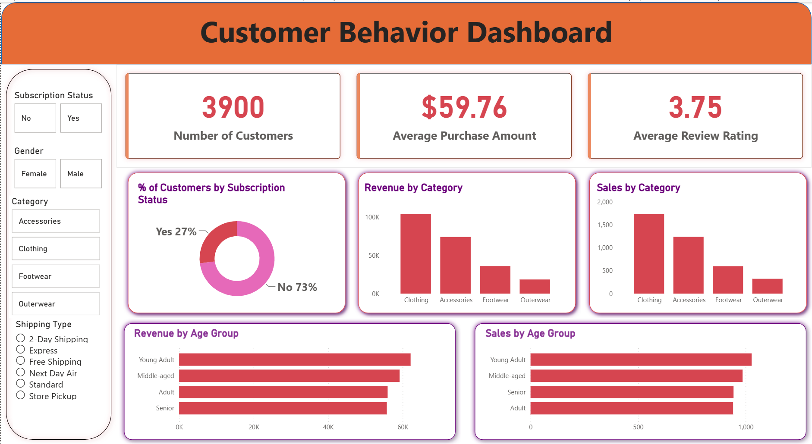

# Customer Shopping Behavior Analysis

End-to-end data analytics project: raw customer data cleaned in **Python**, stored and queried in **MySQL**, and presented in an interactive **Power BI** dashboard.



## Business Problem

A retailer selling clothing, accessories, footwear and outerwear wants to understand who its customers are, what they buy, and whether subscriptions, discounts and shipping options change how much they spend.

## Project at a Glance

| | |
| --- | --- |
| **Dataset** | 3,900 customer purchases, 18 fields |
| **Total revenue** | $233,081 |
| **Average purchase** | $59.76 |
| **Average review rating** | 3.75 / 5 |
| **Tools** | Python (pandas), MySQL, Power BI (DAX), Jupyter Notebook |

## Workflow

```
Raw Data (Excel) → Python (clean + feature engineering) → MySQL → SQL analysis → Power BI dashboard
```

### 1. Data Cleaning and Feature Engineering (Python)

| Step | Action |
| --- | --- |
| Missing values | Filled 37 missing review ratings with the median rating of each product category |
| Column names | Converted to snake_case (e.g. `Purchase Amount (USD)` → `purchase_amount`) |
| Age groups | Created `age_group` using quartiles: Young Adult (18–31), Adult (32–44), Middle-aged (45–57), Senior (58–70) |
| Purchase frequency | Mapped text labels (Weekly, Monthly, etc.) to a numeric `purchase_frequency_days` |
| Redundant column | Confirmed `promo_code_used` matches `discount_applied` in every row, then dropped it |

### 2. Database Integration (MySQL)

The cleaned DataFrame is loaded into a `customer_behavior` database as the `customer` table using SQLAlchemy and `psycopg2`. The notebook also includes connection templates for MySQL and SQL Server.

### 3. SQL Analysis

Ten business questions answered with aggregations, subqueries, CTEs, CASE logic and window functions (see `SQL_Queries.txt`).

| # | Question | Result |
| --- | --- | --- |
| 1 | Revenue by gender | Male $157,890 · Female $75,191 |
| 2 | Discount users who spent above the average purchase | 839 customers |
| 3 | Top 5 products by average rating | Gloves 3.86, Sandals 3.84, Boots 3.82, Hat 3.80, Handbag 3.78 |
| 4 | Standard vs Express shipping, average spend | Express $60.48 · Standard $58.46 |
| 5 | Do subscribers spend more? | Subscribers $59.49 avg · Non-subscribers $59.87 avg |
| 6 | Top 5 products by discount rate | Hat 50.0%, Sneakers 49.7%, Coat 49.1%, Sweater 48.2%, Pants 47.4% |
| 7 | Customer segments (New / Returning / Loyal) | Loyal 3,116 · Returning 701 · New 83 |
| 8 | Top 3 products per category | Jewelry, Blouse, Pants, Sandals, Jacket and more (ranked with `ROW_NUMBER`) |
| 9 | Are repeat buyers more likely to subscribe? | 27.6% of repeat buyers subscribe, close to the 27% overall rate |
| 10 | Revenue by age group | Young Adult $62,143 · Middle-aged $59,197 · Adult $55,978 · Senior $55,763 |

### 4. Power BI Dashboard

- **3 KPI cards (DAX measures):** Number of Customers, Average Purchase Amount, Average Review Rating
- **5 visuals:** subscription split (donut), revenue and sales by category, revenue and sales by age group
- **4 slicers:** Subscription Status, Gender, Category, Shipping Type
- Connected directly to the MySQL `customer` table; every slicer filters every visual

## Key Findings

- **Revenue is concentrated.** Clothing ($104K) and Accessories ($74K) bring in 77% of revenue.
- **Subscriptions do not lift spending.** 27% of customers subscribe, but subscribers spend about the same per purchase as everyone else.
- **Discounts are common but not effective.** 43% of purchases use a discount, yet discounted orders average $59.28 versus $60.13 without one.
- **Spending is even across age groups.** The highest group (Young Adult) leads the lowest by only 11%.
- **The customer base is established.** 80% of customers have more than 10 previous purchases; only 2% are new.

## Recommendations

1. Redesign the subscription offer (free shipping, early access) and test it against a control group.
2. Review discount depth, starting with Hats, Sneakers and Coats, which are discounted most often.
3. Grow Footwear and Outerwear and invest in attracting new customers.
4. Recalibrate loyalty tiers so the "Loyal" segment is a smaller, more valuable group.

## Repository Contents

| File | Description |
| --- | --- |
| `Customer_Shopping_Behavior_Analysis.ipynb` | Data cleaning, feature engineering and database loading |
| `SQL_Queries.txt` | The 10 business queries |
| `PowerBI_dashboard.pbix` | Interactive Power BI dashboard |
| `Customer_Analysis_Report.docx` | Full project report |
| `Raw Data.xlsx` | Source dataset |
| `Dashboard_screenshot.png` | Dashboard preview |

## How to Reproduce

1. Save `Raw Data.xlsx` as `customer_shopping_behavior.csv` in the same folder as the notebook.
2. Install the libraries: `pip install pandas sqlalchemy psycopg2-binary`
3. Create a MySQL database named `customer_behavior`.
4. In the notebook, replace the placeholder credentials with your own and run all cells. This creates the `customer` table.
5. Run the queries in `SQL_Queries.txt` in pgAdmin or `psql`.
6. Open `PowerBI_dashboard.pbix` in Power BI Desktop and point the data source at your database.

## Author

**Ommkar Sahoo**, B.Tech, Metallurgical Engineering and Materials Science, IIT Indore
[GitHub](https://github.com/ommkar-sahoo2005) · [LinkedIn](https://www.linkedin.com/in/ommkar-sahoo/)
